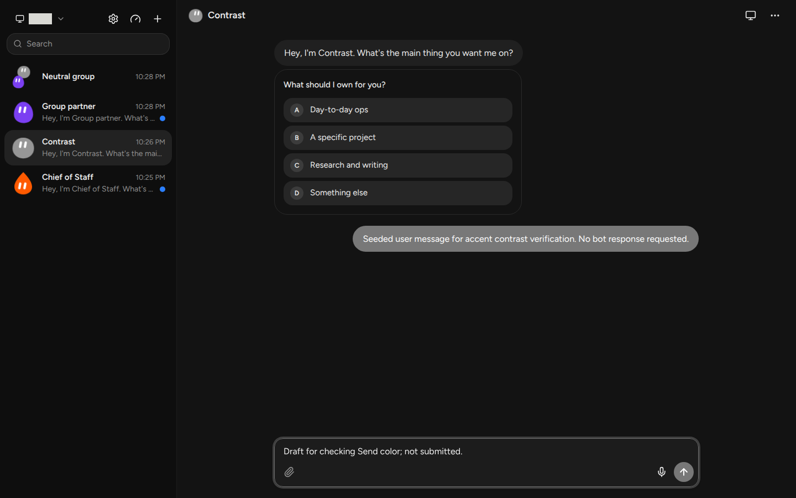
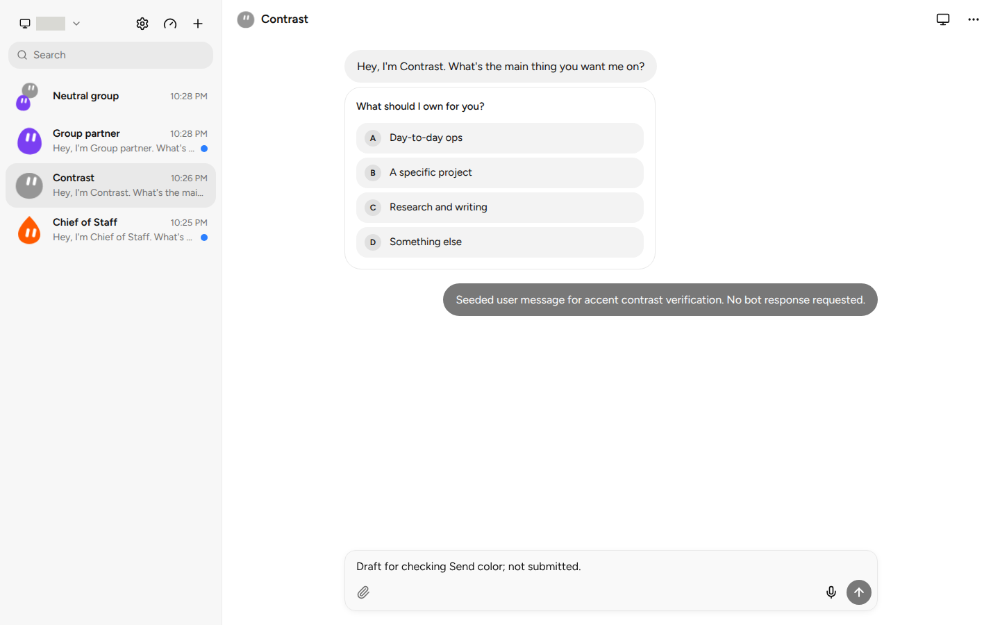

# Review follow-up verification

The follow-up compares the actual contrast ratios for white and `#111111` on the existing deepened bot color. Background colors and the near-black fallback are unchanged. For a custom `#969696` bot, the `#787878` accent now uses white text (4.42:1) rather than near-black (4.28:1). Choosing the better of these two does not guarantee 4.5:1 for every custom color.

Used the project's verify-fabs-bot skill in a fresh isolated instance on port 4950, with dedicated data and browser state. Doctor confirmed ownership, isolation and a fresh web build. No agent turn was requested. The user message in these screenshots was inserted as a history fixture; the bot greeting is the app's built-in greeting.

| Dark | Light |
|---|---|
|  |  |

Checked through the UI and computed styles:

- Mouse selection, ArrowLeft/ArrowRight and reload persistence of Bot color; Neutral removes the stored accent.
- The gray user bubble and enabled Send button both use `rgb(120, 120, 120)` with white text in both themes.
- Neighboring custom grays: `#979797` gets white text on `rgb(121, 121, 121)`; `#989898` gets near-black text on `rgb(122, 122, 122)`.
- Red retains white text; amber retains near-black text. A near-black bot falls back to Neutral in both themes. A group stays neutral with no inline accent.

All 63 existing tests passed, with 143 assertions. No new expected-behavior tests were added. Privacy scanning passed; the new screenshots and converted motion evidence were visually inspected. The isolated browser and server were cleaned up after verification.

[Picking an accent (MP4)](pick-accent.mp4) replaces the original GIF. It is an H.264 conversion of the original recording, preserving its 140 frames, 14-second duration and 960×600 dimensions. It decoded without errors; sampled frames were visually inspected. It is not a new recording or proof of a new real exchange.

The original implementation recorded real exchange and approval-flow evidence. The Astra reviewer independently checked the UI and that evidence, but its attempt at a real Claude exchange hit the account's five-hour limit. This follow-up did not retry that limit or independently complete a real bot reply, approval flow, live screen hand-over or Electron launcher check.
